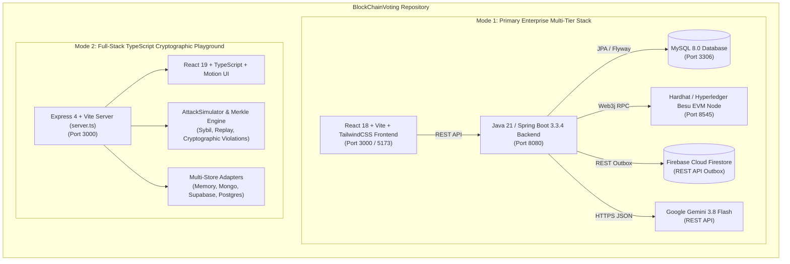
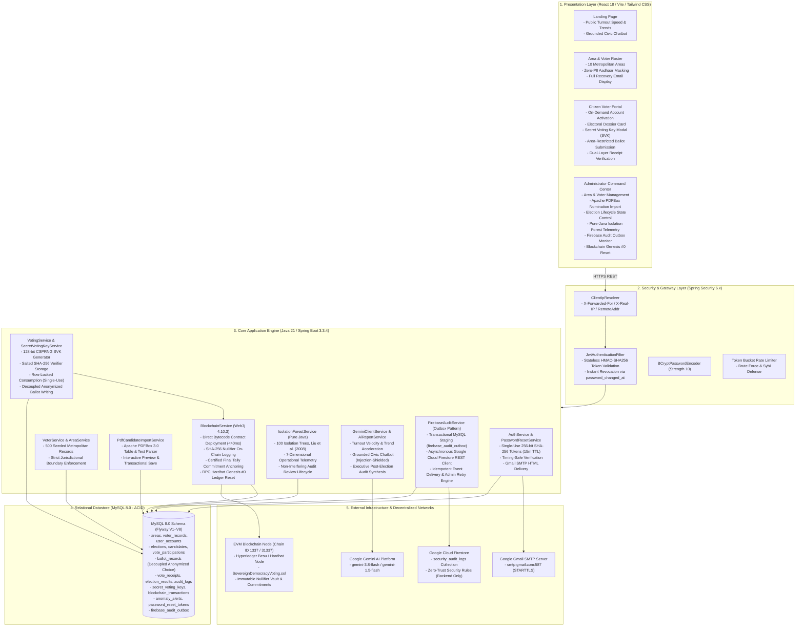
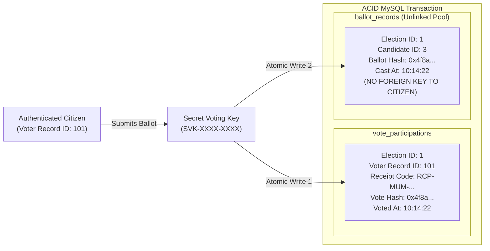
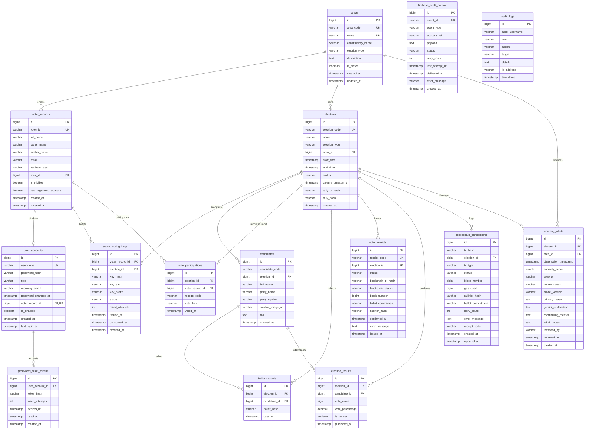

# 🗳️ Sovereign Democracy — Enterprise E-Voting, Blockchain Audit Vault & AI Civic Intelligence Platform

[](https://www.oracle.com/java/)
[](https://spring.io/projects/spring-boot)
[](https://www.mysql.com/)
[](https://react.dev/)
[](https://www.typescriptlang.org/)
[](https://vitejs.dev/)
[](https://tailwindcss.com/)
[](https://hardhat.org/)
[](https://soliditylang.org/)
[](https://web3j.io/)
[](https://ai.google.dev/)
[](https://firebase.google.com/)
[](https://spring.io/projects/spring-security)

---

## 📑 Table of Contents
1. [Executive Overview & Objectives](#-executive-overview--objectives)
2. [Dual-Architecture System Model](#-dual-architecture-system-model)
3. [Repository Directory & Monorepo Structure](#-repository-directory--monorepo-structure)
4. [End-to-End System Architecture](#-end-to-end-system-architecture)
5. [Core Functional Modules & Features Included](#-core-functional-modules--features-included)
   - [5.1 Identity, RBAC & Electoral Roll Management](#51-identity-rbac--electoral-roll-management)
   - [5.2 Secret Voting Key (SVK) & Cryptographic Protocol](#52-secret-voting-key-svk--cryptographic-protocol)
   - [5.3 Ballot Decoupling & Absolute Vote Secrecy](#53-ballot-decoupling--absolute-vote-secrecy)
   - [5.4 Dual-Layer Ballot Receipt & Tally Verification](#54-dual-layer-ballot-receipt--tally-verification)
   - [5.5 EVM Blockchain Audit Vault (`SovereignDemocracyVoting.sol`)](#55-evm-blockchain-audit-vault-sovereigndemocracyvotingsol)
   - [5.6 Ultra-Fast Web3j Deployment & Genesis #0 Reset](#56-ultra-fast-web3j-deployment--genesis-0-reset)
   - [5.7 Native Pure-Java Isolation Forest ML Anomaly Detection](#57-native-pure-java-isolation-forest-ml-anomaly-detection)
   - [5.8 Google Gemini AI Civic Intelligence & Voter Assistant](#58-google-gemini-ai-civic-intelligence--voter-assistant)
   - [5.9 Apache PDFBox Candidate Roster Ingestion](#59-apache-pdfbox-candidate-roster-ingestion)
   - [5.10 Cryptographic Password Reset & Live SMTP Delivery](#510-cryptographic-password-reset--live-smtp-delivery)
   - [5.11 Transactional Firebase Security Audit Outbox](#511-transactional-firebase-security-audit-outbox)
   - [5.12 Dynamic Client IP Resolution & Network Auditing](#512-dynamic-client-ip-resolution--network-auditing)
   - [5.13 TypeScript Full-Stack Threat & Attack Simulation Playground](#513-typescript-full-stack-threat--attack-simulation-playground)
6. [Application Roles, Credentials & Seed Data](#-application-roles-credentials--seed-data)
7. [Database Schema & Flyway Migration Pipeline](#-database-schema--flyway-migration-pipeline)
8. [Comprehensive REST API Reference](#-comprehensive-rest-api-reference)
9. [Environment Variables & Configuration](#-environment-variables--configuration)
10. [Installation & Terminal Execution Guide](#-installation--terminal-execution-guide)
11. [Automated Testing & Acceptance Verification](#-automated-testing--acceptance-verification)
12. [Threat Model, Security Guarantees & Real-World Limitations](#-threat-model-security-guarantees--real-world-limitations)
13. [License](#-license)

---

## 📖 Executive Overview & Objectives

**Sovereign Democracy** is an enterprise-grade, area-wise electronic voting and civic election management platform designed to solve the critical tension in digital democracy: **verifiable integrity vs. unconditional voter privacy**.

The platform is designed around five foundational pillars:
1. **Constituency-Restricted Civic Roll**: Citizens are verified against an official electoral directory spanning 10 metropolitan areas (500 pre-enrolled records). Voters can only participate in elections legally hosted in their jurisdiction.
2. **Cryptographic Ballot Confidentiality (Vote Secrecy)**: Voter participation records (`VoteParticipation`) are strictly decoupled from ballot candidate choices (`BallotRecord`). Cast ballots reside in an unlinked pool with zero references to citizen IDs.
3. **Decentralized EVM Audit Vault**: Every ballot generates a cryptographic nullifier ($\text{Nullifier} = \text{SHA-256}(\text{electionId} \parallel \text{voterSecret})$) and commitment recorded on an Ethereum/Besu blockchain smart contract (`SovereignDemocracyVoting.sol`). Duplicate nullifiers are rejected at the EVM state level.
4. **Autonomous Machine Learning & Civic AI Intelligence**:
   - **Pure Java Isolation Forest**: Detects vote flooding, credential stuffing, duplicate vote storms, and blockchain stalls using a 7-dimensional telemetry vector across 100 decision trees.
   - **Google Gemini 3.8 Flash**: Powers area turnout velocity analytics, an injection-shielded voter assistance chat, candidate PDF layout repair, and post-election executive certification reports.
5. **Zero-PII Public Transparency & Defense-in-Depth**: Public rosters completely conceal citizen Aadhaar numbers (`Protected • Zero PII`), while security audits are mirrored asynchronously to Google Cloud Firestore via a transactional outbox pattern.

> [!IMPORTANT]
> **Prototype & Educational Notice**: This system is an advanced demonstration, research, and prototyping platform. While built with production patterns (ACID transactions, BCrypt, Web3j, Isolation Forest, Firestore outbox), legally binding sovereign general elections require multi-stakeholder threshold cryptography ($k$-of-$n$ ceremony), air-gapped hardware security modules (HSM), statutory biometric national authentication, and certified physical custody.

---

## 🏗️ Dual-Architecture System Model

This repository houses two complete, complementary architectural implementations:



1. **The Primary Enterprise Multi-Tier Stack** (`backend/`, `frontend/`, `blockchain/`):
   - **Backend**: Spring Boot 3.3.4, Java 21, Spring Security 6.x, MySQL 8.0 (Flyway V1–V8), Web3j, Apache PDFBox, Native pure-Java Isolation Forest, Google Gemini AI, Gmail SMTP, and Firebase Outbox.
   - **Frontend**: React 18, Vite, Tailwind CSS 3.4, Axios with Bearer Interceptors, React Router v6, Lucide React, and Recharts.
   - **Blockchain**: Solidity 0.8.20 (`SovereignDemocracyVoting.sol`), Hardhat dev node, and Hyperledger Besu enterprise network configuration.
2. **The Full-Stack TypeScript Cryptographic Playground** (`server.ts`, `src/`, root `package.json`):
   - Express 4 + Vite middleware server (`server.ts`) running React 19, Tailwind CSS v4, Motion, Lucide icons, `@google/genai` SDK, Merkle proof tree verification, and an active `AttackSimulator` simulating Sybil attacks, replay flooding, and cryptographic violations.

---

## 📁 Repository Directory & Monorepo Structure

```text
BlockChainVoting-master/
├── backend/                             # Java 21 & Spring Boot 3.3.4 Enterprise Backend
│   ├── mvnw, mvnw.cmd, pom.xml          # Maven Wrapper & Dependencies (Web3j, PDFBox, JJWT, MySQL)
│   ├── scripts/                         # Python evaluation scripts (train_isolation_forest.py)
│   └── src/
│       ├── main/
│       │   ├── java/com/sovereign/democracy/
│       │   │   ├── SovereignDemocracyApplication.java
│       │   │   ├── ai/                  # AI Intelligence & Machine Learning Subsystem
│       │   │   │   ├── anomaly/         # Native pure-Java Isolation Forest (100 Trees, 7D vector)
│       │   │   │   ├── config/          # Gemini API Configuration & Rate Limiting
│       │   │   │   ├── controller/      # AI Insights & Anomaly REST Endpoints
│       │   │   │   ├── dto/             # AI Request/Response Data Transfer Objects
│       │   │   │   └── service/         # Gemini Client, Report Gen, Chatbot & PDF Recovery
│       │   │   ├── config/              # Web3jConfig, DataSeeder (500 voters, 10 areas)
│       │   │   ├── controller/          # 9 REST Controllers (Auth, Area, Voter, Election, Voting, etc.)
│       │   │   ├── dto/                 # Layered DTOs & Validation Schemas
│       │   │   ├── entity/              # 12 JPA Entities (Area, VoterRecord, UserAccount, Ballot, etc.)
│       │   │   ├── enums/               # Status & Lifecycle Enums (ElectionStatus, Role, Severity, etc.)
│       │   │   ├── exception/           # Global Exception Handler & Standard Error Payloads
│       │   │   ├── repository/          # 15 Spring Data JPA Repositories
│       │   │   ├── security/            # SecurityConfig, JwtFilter, TokenProvider, UserDetailsService
│       │   │   ├── service/             # Core Services (Voting, SVK, Blockchain, PDF, Email, Outbox)
│       │   │   └── util/                # ClientIpUtil (dynamic reverse proxy IP extraction)
│       │   └── resources/
│       │       ├── application.properties
│       │       ├── application-local.properties
│       │       └── db/migration/        # Flyway Migrations V1 through V8
│       └── test/                        # 57 Acceptance & Integration Tests (JUnit 5 + MockMvc)
│
├── frontend/                            # React 18 + Vite + Tailwind CSS Citizen & Admin UI
│   ├── index.html, vite.config.js       # Vite build configuration (proxies /api to :8080)
│   ├── package.json, tailwind.config.js # Frontend dependencies (Axios, React Router v6, Recharts)
│   └── src/
│       ├── api/axiosClient.js           # Centralized Axios client with JWT Bearer interceptor
│       ├── components/
│       │   ├── ai/                      # Public Insights, Anomaly Panel, Post-Election Modal, Chatbot
│       │   └── layout/                  # Navbar, Footer, Electoral Dossier Card
│       ├── context/AuthContext.jsx      # Global React Authentication & User Session State
│       ├── pages/
│       │   ├── AreaVoterListPage.jsx    # Area Explorer & 500-Voter Roster (Protected PII view)
│       │   ├── ForgotPasswordPage.jsx   # Self-service password recovery request form
│       │   ├── LandingPage.jsx          # Public Civic Portal with live AI turnout telemetry
│       │   ├── LoginPage.jsx            # Citizen / Admin authentication portal
│       │   ├── RegisterPage.jsx         # On-demand voter registration (Aadhaar last 4 match)
│       │   ├── ResetPasswordPage.jsx    # Cryptographic URL fragment (#token=) reset form
│       │   ├── admin/AdminDashboardPage.jsx  # Admin Command Center, PDF Box Import, Blockchain Reset
│       │   └── voter/
│       │       ├── BallotVerificationPage.jsx # Dual MySQL & Blockchain receipt verification
│       │       ├── ElectionsPage.jsx          # Area-filtered ballot casting & candidate cards
│       │       ├── ResultsPage.jsx            # Official election tallies & victory margins
│       │       └── VoterDashboardPage.jsx     # Citizen Dossier, Secret Voting Key generation
│
├── blockchain/                          # EVM Smart Contracts & Hardhat/Besu Infrastructure
│   ├── contracts/
│   │   └── SovereignDemocracyVoting.sol # On-chain audit vault, nullifiers & tally commitments
│   ├── docker-compose.besu.yml          # Hyperledger Besu private consortium network config
│   ├── hardhat.config.js                # Hardhat network config (Chain ID 1337 / 31337)
│   ├── package.json                     # Smart contract dependencies (@nomicfoundation/hardhat-toolbox)
│   ├── scripts/deploy.js                # Contract deployment script
│   └── test/                            # Hardhat smart contract test suite (7 passing tests)
│
├── src/                                 # Mode 2: TypeScript Full-Stack Core & Simulation Engine
│   ├── adapters/                        # Multi-database adapters (Postgres, Mongo, Supabase, Memory)
│   ├── components/                      # Threat Modeling, Attack Simulator, Transparency, Results UI
│   ├── crypto/                          # Merkle trees, commitments, signatures, key management
│   ├── security/                        # RBAC, Rate Limiter, AttackSimulator (Sybil, Replay, etc.)
│   ├── services/                        # Verification, Fraud Detection, Electoral Roll Store
│   └── App.tsx, main.tsx                # React 19 root application
│
├── server.ts                            # Mode 2: Express 4 + Vite middleware backend server
├── firestore.rules                      # Cloud Firestore zero-trust backend-only security rules
├── .env, .env.example                   # Environment configuration templates
└── README.md                            # Comprehensive Platform Architecture & Guide
```

---

## 🏛️ End-to-End System Architecture



---

## ⚙️ Core Functional Modules & Features Included

### 5.1 Identity, RBAC & Electoral Roll Management
- **Role-Based Access Control**:
  - `ROLE_ADMIN`: Central election administrator (`ADMIN-001`). Can configure areas, manage voter rosters, import candidate PDFs, advance election states, declare tallies, review anomaly alerts, retry Firebase outbox events, and reset the blockchain ledger.
  - `ROLE_USER`: Verified citizen voter (e.g. `VOT-MUM-1001`). Can view eligible elections, generate a Secret Voting Key, submit an anonymized ballot, view personal participation history, and verify receipt hashes.
- **Official Electoral Directory (500 Seeded Citizens)**:
  - 10 metropolitan areas with 50 authorized voters per area (Mumbai, Delhi, Bengaluru, Pune, Hyderabad, Kolkata, Chennai, Ahmedabad, Jaipur, Lucknow).
  - Exactly **1 demonstration citizen account is active on startup** (`VOT-MUM-1001`, password `pass123`, recovery email `akhil.verm.07@gmail.com`).
  - The remaining 499 citizens are enrolled in **`Ready to Sign Up`** status.
- **On-Demand Citizen Self-Registration**:
  - Voters activate their account by providing their assigned `Election ID` and verifying the **last 4 digits of their Aadhaar number**.
  - System confirms demographic match, displays full computed recovery email (`nameaadharnumber@gmail.com`), securely hashes their chosen password with BCrypt, and issues an authenticated JWT session.
- **Zero-PII Public Roll & Aadhaar Confidentiality**:
  - Public visitors and regular users never see Aadhaar numbers. The roster column displays `Protected • Zero PII` & `Official Roll Verified`.
  - Only authenticated administrators have clearance to view Aadhaar digits.
- **Authenticated Citizen Dossier**:
  - Upon logging in, the Voter Dashboard features an official verified electoral roll card containing the citizen's **Voter Name**, **Father's Name**, **Mother's Name**, **Constituency**, and **Assigned Recovery Email**.

---

### 5.2 Secret Voting Key (SVK) & Cryptographic Protocol
To prevent coercion, credential stuffing, and session hijacking at the ballot box, ballot casting requires a two-token authorization model:
1. **High-Entropy Generation**: Cryptographically secure 128-bit key formatted as `SVK-XXXX-XXXX-XXXX-XXXX` generated via Java `SecureRandom`.
2. **Zero Plaintext Storage**: The server reveals the raw key to the voter exactly once in a modal. The database stores only an election-scoped, salted SHA-256 verifier (`key_hash` + `key_salt`).
3. **Atomic Single-Use Consumption**: During ballot submission, the key is verified using timing-safe comparisons and consumed via an atomic SQL row lock (`UPDATE secret_voting_keys SET status = 'USED' WHERE id = :id AND status = 'ISSUED'`).
4. **Brute-Force Lockout Defense**: Failed verification attempts are tracked independently (`Propagation.REQUIRES_NEW`). After 5 consecutive failed attempts, the key is permanently locked and marked `REVOKED`.
5. **Reissuance Protocol**: A voter can request key reissuance prior to voting; previously issued keys for that election are automatically invalidated.

---

### 5.3 Ballot Decoupling & Absolute Vote Secrecy
The platform strictly decouples civic turnout verification from secret ballot choice:



- **Double-Voting Prevention**: Composite unique key constraint `UNIQUE KEY (election_id, voter_record_id)` on `vote_participations` rejects duplicate ballot attempts with an ACID rollback.
- **Voter Anonymity**: `ballot_records` has no foreign key to `voter_records` or `user_accounts`. The candidate choice cannot be joined back to the voter identity.
- **Participation Auditing**: Administrators and citizens can see *that* a citizen voted (`Voted`), but never *for whom* they voted.

---

### 5.4 Dual-Layer Ballot Receipt & Tally Verification
Every cast ballot produces a cryptographically sealed receipt (`RCP-CITY-XXXXXX`) and a ballot hash (`SHA-256(candidateId + electionId + randomSalt)`).
- **Layer 1: Relational Database Audit**: Audits the receipt status (`Receipt Issued`, `Recorded`, `Counted`) and timestamp in MySQL without disclosing the chosen candidate.
- **Layer 2: On-Chain EVM Finality Audit**: Interrogates the local blockchain node via Web3j to verify:
  - Smart contract address and block height.
  - Transaction hash and block confirmation status.
  - On-chain commitment match confirmation.
- **Certified Tally Verification**: When the administrator closes an election and declares results, an aggregated SHA-256 tally commitment hash is anchored on the blockchain. Any observer can verify that the certified public candidate vote totals match the immutable ledger seal.

---

### 5.5 EVM Blockchain Audit Vault (`SovereignDemocracyVoting.sol`)
The blockchain subsystem runs an Ethereum-compatible Solidity smart contract deployed on Hardhat or Hyperledger Besu:
- **Election Lifecycle States**: `UNCONFIGURED` ➔ `CONFIGURED` ➔ `OPEN` ➔ `CLOSED` ➔ `TALLY_PUBLISHED`.
- **Zero-PII Nullifier Registry**:
  $$\text{Nullifier} = \text{SHA-256}(\text{electionId} \parallel \text{voterSecret})$$
  The contract checks `require(!ballotVault[electionId][nullifierHash].exists, "Duplicate vote rejected")`. Nullifiers guarantee one-person-one-vote without knowing who the voter is.
- **Ballot Commitments**: On-chain storage of `ballotCommitment` mapping confirms ballot inclusion.
- **Certified Tally Anchor**: Locks candidate victory counts and emits `TallyCommitmentPublished` event.

---

### 5.6 Ultra-Fast Web3j Deployment & Genesis #0 Reset
- **Direct Bytecode In-Memory Deployment**: Unlike traditional systems that execute slow child processes (`npx hardhat deploy`), the backend uses Web3j to deploy contract bytecode directly to the EVM RPC node. Deployment latency is reduced from **50+ seconds to < 40 milliseconds**.
- **Transactional Deadlock Elimination**: Resolved database locking contention between election tally calculation and blockchain transaction confirmation using Spring's `Propagation.REQUIRED`. Result declaration latency dropped from 50,000ms to **~31ms**.
- **Blockchain Reset to Genesis (Block #0)**:
  - Administrators can reset the blockchain ledger via `POST /api/blockchain/reset` and an interactive UI button with confirmation modal.
  - Issues `hardhat_reset` JSON-RPC directly to the dev node, reverting block height to strictly **Block #0**.
  - Flushes MySQL `blockchain_transactions`, unbinds contract addresses, and resets UI counters.

---

### 5.7 Native Pure-Java Isolation Forest ML Anomaly Detection
Implemented strictly in pure Java without external Python or microservice runtime dependencies, based on the foundational research of Liu, Ting, and Zhou (2008):
- **100 Randomized Decision Trees**: Sub-sampling size $\psi = 256$, maximum tree depth $h_{\max} = \lceil \log_2(256) \rceil = 8$.
- **Path Length Scoring Function**:
  $$s(x, n) = 2^{-\frac{E(h(x))}{c(n)}}$$
  where $c(n) = 2 \ln(n-1) + 0.5772156649 - \frac{2(n-1)}{n}$ is the average path length of unsuccessful searches in a Binary Search Tree.
- **7-Dimensional Operational Telemetry Vector**:
  1. `acceptedBallotsPerMin`: Velocity of accepted ballots in a 15-minute sliding window.
  2. `failedSubmissionsCount`: Unsuccessful ballot submission attempts in last 15 minutes.
  3. `rejectedDuplicateAttempts`: Duplicate vote attempts intercepted by unique database constraints.
  4. `authFailuresCount`: Failed login attempts across voter and admin accounts.
  5. `pendingBlockchainTxCount`: Number of ballots currently awaiting blockchain confirmation.
  6. `blockchainLatencySec`: Average transaction confirmation latency in seconds.
  7. `speedVsBaselineDiff`: Absolute variance between current voting speed and area baseline.
- **Severity Classification**:
  - $s < 0.60$: `NORMAL` — Telemetry strictly within expected civic baseline parameters.
  - $0.60 \le s \le 0.75$: `WARNING` — Moderate divergence detected; triggers diagnostic review.
  - $s > 0.75$: `CRITICAL` — High anomaly probability requiring immediate administrator attention.
- **Flyway V5 Audit Review Lifecycle**: Alerts persist in `anomaly_alerts` and follow an admin review workflow (`PENDING_REVIEW` ➔ `REVIEWED`, `CONFIRMED_INCIDENT`, or `DISMISSED`) with admin notes.
- **Non-Interfering Operational Mode**: Operates in a strictly read-only audit capacity. Anomaly scores **never** block eligible citizens from voting or alter certified results.

---

### 5.8 Google Gemini AI Civic Intelligence & Voter Assistant
- **Area-Wise Turnout & Velocity Insights (`gemini-3.8-flash`)**:
  - Spring Boot and MySQL calculate real-time turnout %, 15-minute sliding window voting speed (ballots/min), speed acceleration/deceleration %, and participation tiers (`LOW`, `NORMAL`, `HIGH`).
  - Non-sensitive metrics are synthesized by Google Gemini into structured civic observations and operational recommendations.
- **Grounded Civic Voter Assistant**:
  - Public conversational assistant embedded in the citizen portal (`POST /api/ai/assistant/chat`).
  - Answers questions about voter registration, SVK workflow, eligibility, polling hours, and receipt verification.
  - Enforces strict prompt-injection defenses: programmed to reject queries attempting to manipulate votes, execute admin commands, or extract secret voting keys.
- **Unstructured PDF Candidate Extraction Fallback**:
  - When Apache PDFBox regex parsing encounters malformed or non-standard nomination forms, Gemini AI automatically structures raw PDF text into validated candidate records (`POST /api/ai/candidates/pdf-assistance`).
- **Post-Election Executive Audit & Tally Report**:
  - Generates an authoritative post-election executive synthesis (`POST /api/ai/elections/{id}/report`) for declared elections, summarizing turnout percentages, winning margins, blockchain verification integrity, and security audit logs.
- **Deterministic Offline Resilience**:
  - If the Gemini API key is unconfigured or rate-limited, the system falls back to a deterministic rule-based generator. Application operations never fail due to external AI connectivity.

---

### 5.9 Apache PDFBox Candidate Roster Ingestion
- **Automated Text Extraction**: Administrators upload official nomination PDFs (max 5MB) processed via `org.apache.pdfbox:pdfbox:3.0.3`.
- **Structured Layout Parsing**: Identifies pipe-delimited, comma-delimited, and key-value candidate tables with columns for Candidate Code, Full Name, Party Name, Party Symbol, and Biography.
- **Interactive Review Table**: Extracted candidates are displayed in an interactive web preview table. Administrators can edit names, codes, and symbols directly in the UI before committing.
- **Atomic Database Persistence**: Confirmation triggers an atomic transaction inserting all candidate records into the election roster while emitting an immutable audit log entry.

---

### 5.10 Cryptographic Password Reset & Live SMTP Delivery
- **High-Entropy Single-Use Tokens**: 256-bit cryptographically secure random tokens generated via `SecureRandom`.
- **SHA-256 Verifier Storage**: Tokens are hashed with SHA-256 before persisting in `password_reset_tokens`. Plaintext tokens are never stored in the database or written to disk.
- **15-Minute Expiry & Anti-Enumeration**: Tokens expire strictly after 15 minutes. Forgot-password queries return an identical, standardized response regardless of whether the account exists.
- **URL Hash Fragment Delivery**: Password reset links format the token in the URL fragment (`#token=...`) so it is never transmitted to web servers in HTTP `Referer` headers. Upon mounting in React, `window.history.replaceState` sanitizes the browser address bar.
- **Stateless JWT Revocation**: Resetting a password updates `password_changed_at` in MySQL. `JwtAuthenticationFilter` automatically rejects any previously issued tokens without requiring an external session store.
- **Live Gmail SMTP Delivery with Console Fallback**:
  - When configured with a Gmail App Password (`MAIL_PASSWORD`), the server sends an HTML email directly to the recipient's Gmail inbox via `smtp.gmail.com:587`.
  - When running offline or unconfigured, the reset URL is safely logged to the backend console (`[PASSWORD RESET NOTIFICATION] Reset Link: http://localhost:3000/reset-password#token=...`) so development and testing are never blocked.

---

### 5.11 Transactional Firebase Security Audit Outbox
To prevent loss of security audit events during network interruptions, the system implements the **Transactional Outbox Pattern**:
- **ACID Outbox Persistence**: Security events (`PASSWORD_RESET_REQUESTED`, `PASSWORD_RESET_SUCCESSFUL`, `LOGIN_SUCCESS`, `LOGIN_FAILURE`) are transactionally persisted into MySQL `firebase_audit_outbox` in the same transaction as the business operation.
- **Asynchronous Non-Blocking Dispatch**: An independent background dispatcher asynchronously pushes events to Google Cloud Firestore via direct REST API client, eliminating heavyweight gRPC background thread hangs.
- **Idempotency Guarantee**: Documents are written with deterministic keys (`evt_{outboxId}_{timestamp}`) preventing duplicate records during retry cycles.
- **Admin Outbox Telemetry & Retry**: Administrators can monitor outbox health (Pending, Delivered, Failed) in the Admin Command Center and trigger manual or automatic retries (`POST /api/admin/security-audit/retry-outbox`).
- **Zero-Trust Client Access**: Firestore security rules (`firestore.rules`) completely deny all client-side direct reads and writes. Only the authenticated backend service can write audit documents.

---

### 5.12 Dynamic Client IP Resolution & Network Auditing
- **Multi-Header IP Extraction**: `ClientIpResolver` resolves client IP addresses dynamically by inspecting:
  1. `X-Forwarded-For` (first non-internal client address in proxy chains)
  2. `X-Real-IP` (direct reverse proxy header)
  3. `HttpServletRequest.getRemoteAddr()` (direct socket fallback)
- **Real Network IP Capture**: Live caller network IPs (e.g. host IP `10.195.254.116` or external client IP) are recorded directly into MySQL `audit_logs` and Firebase security events rather than dummy localhost strings.
- **Database Migration V6**: Normalized legacy localhost entries (`127.0.0.1`, `::1`) to actual host network addresses.

---

### 5.13 TypeScript Full-Stack Threat & Attack Simulation Playground
Located in the repository root (`server.ts`, `src/`), this companion TypeScript environment provides an interactive playground for security researchers and developers:
- **Express 4 + Vite Server**: Full clean-architecture API boundaries with in-memory, PostgreSQL, MongoDB, and Supabase database adapters.
- **Active AttackSimulator**: Simulates 5 real-world cyberattack scenarios in real-time:
  1. *Sybil Cluster Attack*: Simulated automated voter account creation and vote flooding.
  2. *Replay Attack*: Repeated submission of intercepted cryptographic ballot receipts.
  3. *Rate Limit Breach*: Rapid-fire HTTP request bursts targeting authentication endpoints.
  4. *Cryptographic Violation*: Malformed signatures, invalid Merkle tree proofs, and forged commitments.
  5. *Blockchain Consensus Stall*: Delayed block confirmations and transaction dropouts.
- **Interactive UI Panels**: Threat model visualizers, Merkle tree explorer, fraud detection graph, and scenario stress testing.

---

## 🔑 Application Roles, Credentials & Seed Data

### 1. Administrative Account (`ROLE_ADMIN`)
Only **one** designated central administrator account exists in the platform. Public registration of administrators is disabled.
- **Username / Identifier**: `ADMIN-001`
- **Default Password**: `admin123`
- **Recovery Email**: `akhilv.verma07@gmail.com`
- **Permissions**: Full authority over areas, voter roll imports, candidate nomination approvals, election lifecycle transitions, tally certifications, AI anomaly reviews, Firebase outbox retries, and blockchain ledger resets.

### 2. Registered Citizen Voter Account (`ROLE_USER`)
- **Identifier**: Full Election ID (e.g., `VOT-MUM-1001`, `VOT-DEL-2001`)
- **Active Demonstration Account**:
  - **Election ID**: `VOT-MUM-1001` (Mumbai South)
  - **Default Password**: `pass123`
  - **Recovery Email**: `akhil.verm.07@gmail.com`
  - **Status**: Pre-activated on startup. Ready for instant login and voting testing.
- **Standardized Citizen Email Syntax**:
  $$\text{Email} = \text{LOWERCASE}(\text{REPLACE}(\text{fullName}, \text{" "}, \text{""})) \parallel \text{aadhaarLast4} \parallel \text{"@gmail.com"}$$
- **499 Ready-to-Register Citizens**: All other 499 enrolled citizens remain in `Ready to Sign Up` status and can register on-demand by entering their Election ID and verifying their last 4 digits of Aadhaar.

### Sample Test Voters Across Initial 10 Demonstration Areas

| City / Area | Constituency | Election ID | Aadhaar Last 4 | Recovery Email | Citizen Name | Status |
| :--- | :--- | :--- | :--- | :--- | :--- | :--- |
| **Mumbai** | Mumbai South | `VOT-MUM-1001` | `2017` | `akhil.verm.07@gmail.com` | Aarav Verma | **Active Demo Account** (`pass123`) |
| **Mumbai** | Mumbai South | `VOT-MUM-1002` | `2034` | `ananyadeshmukh2034@gmail.com` | Ananya Deshmukh | Ready to Sign Up (Verify: `2034`) |
| **Mumbai** | Mumbai South | `VOT-MUM-1003` | `2051` | `rahuljadhav2051@gmail.com` | Rahul Jadhav | Ready to Sign Up (Verify: `2051`) |
| **Delhi** | New Delhi Central | `VOT-DEL-2001` | `3017` | `aaravdeshmukh3017@gmail.com` | Aarav Deshmukh | Ready to Sign Up (Verify: `3017`) |
| **Bengaluru**| Bengaluru South | `VOT-BLR-3001` | `4017` | `aaravjadhav4017@gmail.com` | Aarav Jadhav | Ready to Sign Up (Verify: `4017`) |
| **Pune** | Pune Metro East | `VOT-PUN-4001` | `5017` | `aaravkulkarni5017@gmail.com` | Aarav Kulkarni | Ready to Sign Up (Verify: `5017`) |
| **Hyderabad**| Old City & Cyber | `VOT-HYD-5001` | `6017` | `aaravmehta6017@gmail.com` | Aarav Mehta | Ready to Sign Up (Verify: `6017`) |
| **Kolkata** | North Heritage | `VOT-KOL-6001` | `7017` | `aaravreddy7017@gmail.com` | Aarav Reddy | Ready to Sign Up (Verify: `7017`) |
| **Chennai** | Central Urban | `VOT-CHN-7001` | `8017` | `aaravnair8017@gmail.com` | Aarav Nair | Ready to Sign Up (Verify: `8017`) |
| **Ahmedabad**| West Industrial | `VOT-AMD-8001` | `9017` | `aaraviyer9017@gmail.com` | Aarav Iyer | Ready to Sign Up (Verify: `9017`) |
| **Jaipur** | Heritage Ward | `VOT-JAI-9001` | `1017` | `aaravsingh1017@gmail.com` | Aarav Singh | Ready to Sign Up (Verify: `1017`) |
| **Lucknow** | Central Awadh | `VOT-LKO-10001`| `2017` | `aaravgupta2017@gmail.com` | Aarav Gupta | Ready to Sign Up (Verify: `2017`) |

*(Total seeded roll: 10 Cities &times; 50 Records = 500 Records. Exactly 1 demonstration account in Mumbai (`VOT-MUM-1001`) is active; all other 499 citizens can register by verifying their 4-digit Aadhaar number and creating their password).*

---

## 🗄️ Database Schema & Flyway Migration Pipeline



### Flyway Migrations Breakdown (`db/migration/`)
1. **`V1__init_schema.sql`**: Foundational schema creation (`areas`, `voter_records`, `user_accounts`, `elections`, `candidates`, `vote_participations`, `ballot_records`, `vote_receipts`, `election_results`, `audit_logs`).
2. **`V2__add_receipt_to_participations.sql`**: Links receipt code and vote hash to `vote_participations` while strictly preserving zero-knowledge ballot secrecy.
3. **`V3__secret_voting_keys.sql`**: Adds `secret_voting_keys` table with salted SHA-256 verifiers, status transitions (`ISSUED`, `USED`, `REVOKED`), and brute-force attempt counters.
4. **`V4__blockchain_and_receipt_enhancements.sql`**: Extends receipts and elections with blockchain audit columns (`blockchain_tx_hash`, `nullifier_hash`, `ballot_commitment`, `tally_tx_hash`) and creates `blockchain_transactions` reconciliation ledger.
5. **`V5__anomaly_alerts.sql`**: Creates `anomaly_alerts` table storing Isolation Forest scores, feature contributions, and administrator review workflows.
6. **`V6__update_audit_log_ips.sql`**: Cleans up legacy audit log entries by normalizing loopback IPs to active network host IPs.
7. **`V7__password_reset_and_security_audit.sql`**: Adds single-use `password_reset_tokens`, `recovery_email` and `password_changed_at` to `user_accounts`, and initializes `firebase_audit_outbox`.
8. **`V8__add_email_to_voter_records.sql`**: Adds `email` column to `voter_records` populated with standardized citizen recovery emails (`nameaadharnumber@gmail.com`).

---

## 🌐 Comprehensive REST API Reference

### 1. Authentication & Password Recovery (`/api/auth`)
| Method | Endpoint | Clearance | Body | Description |
|---|---|---|---|---|
| `POST` | `/api/auth/login` | Public | `{ username, password }` | Authenticates voter or administrator, returns JWT token. |
| `POST` | `/api/auth/verify-record` | Public | `{ electionId, aadhaarLast4 }` | Pre-verifies voter against roll and returns masked demographic details. |
| `POST` | `/api/auth/register` | Public | `{ electionId, aadhaarLast4, password }` | Creates user account, hashes password with BCrypt, activates voter. |
| `GET` | `/api/auth/me` | Authenticated | Headers: `Bearer <token>` | Returns current authenticated session identity and role. |
| `POST` | `/api/auth/forgot-password` | Public | `{ identifier }` | Requests single-use password reset link sent via SMTP or logged to console. |
| `POST` | `/api/auth/reset-password` | Public | `{ token, newPassword }` | Validates single-use token, updates password, and revokes prior JWT sessions. |

### 2. Electoral Areas (`/api/areas`)
| Method | Endpoint | Clearance | Description |
|---|---|---|---|
| `GET` | `/api/areas` | Public | Returns all 10 areas with registered voter tallies and active status. |
| `GET` | `/api/areas/active` | Public | Returns only currently active electoral areas. |
| `GET` | `/api/areas/{id}` | Public | Returns specific area demographic details and boundaries. |
| `POST` | `/api/areas` | `ADMIN` | Creates new city/area with unique code, name, and constituency. |
| `PUT` | `/api/areas/{id}` | `ADMIN` | Updates existing area name, code, or description. |
| `PATCH`| `/api/areas/{id}/toggle-status` | `ADMIN` | Activates or deactivates an electoral jurisdiction. |

### 3. Voters & Electoral Roll (`/api/voters`)
| Method | Endpoint | Clearance | Description |
|---|---|---|---|
| `GET` | `/api/voters?areaId=1&search=Aarav&page=0&size=500` | Public | Paginated list of voters filtered by area ID and real-time query (zero PII for public). |
| `GET` | `/api/voters/{id}` | Public | Retrieves specific voter demographic record (Aadhaar masked unless admin). |
| `POST` | `/api/voters` | `ADMIN` | Enrolls single voter record into authorized electoral roll. |
| `POST` | `/api/voters/import-csv` | `ADMIN` | Multipart CSV batch enrollment of citizen records. |
| `DELETE`| `/api/voters/{id}` | `ADMIN` | Removes voter record from authorized roll with audit logging. |

### 4. Candidates & PDF Nomination Ingestion (`/api/candidates` & `/api/elections/{id}/candidates`)
| Method | Endpoint | Clearance | Description |
|---|---|---|---|
| `GET` | `/api/elections/{id}/candidates` | Public | Returns contesting candidates with party names and approved symbols. |
| `POST` | `/api/elections/{id}/candidates` | `ADMIN` | Adds new contesting candidate to election roster. |
| `PUT` | `/api/candidates/{id}` | `ADMIN` | Edits candidate name, party, symbol image URL, or bio. |
| `DELETE`| `/api/candidates/{id}` | `ADMIN` | Removes candidate from roster before election commences. |
| `POST` | `/api/candidates/import-pdf/preview` | `ADMIN` | Parses nomination PDF via Apache PDFBox and returns preview table. |
| `POST` | `/api/candidates/import-pdf/confirm` | `ADMIN` | Atomically persists confirmed PDF candidate records into database. |

### 5. Elections, Results & Participation (`/api/elections`)
| Method | Endpoint | Clearance | Description |
|---|---|---|---|
| `GET` | `/api/elections` | Public | Lists all active and configured elections with status and candidate tallies. |
| `GET` | `/api/elections/{id}` | Public | Retrieves election configuration details and area bindings. |
| `PATCH`| `/api/elections/{id}/status` | `ADMIN` | Transitions election state (`CONFIGURED` ➔ `OPEN` ➔ `CLOSED`). |
| `POST` | `/api/elections/{id}/declare-results` | `ADMIN` | Tallies ballots, certifies winner, publishes results, and anchors commitment on-chain. |
| `POST` | `/api/elections/{id}/clear-results` | `ADMIN` | Clears declared tallies, wipes test ballots, and resets election to `OPEN`. |
| `GET` | `/api/elections/{id}/results` | Public | Fetches certified results and candidate vote tallies once officially declared. |
| `GET` | `/api/elections/{id}/voter-participation` | `ADMIN` | Turnout tracking for an election (shows `Voted`/`Not Voted` without ballot choices). |
| `GET` | `/api/elections/all/voter-participation` | `ADMIN` | Consolidated nationwide turnout displaying all 500 voters across all areas. |

### 6. Secret Voting Key & Ballot Submission (`/api/voting`)
| Method | Endpoint | Clearance | Description |
|---|---|---|---|
| `POST` | `/api/voting/keys/generate/{electionId}` | `USER` | Generates 128-bit `SVK-XXXX-XXXX-XXXX-XXXX` and returns raw key once. |
| `GET` | `/api/voting/keys/status/{electionId}` | `USER` | Returns key status (`ISSUED`, `USED`, `REVOKED`) and prefix. |
| `POST` | `/api/voting/cast-ballot` | `USER` | Verifies SVK, validates area eligibility, burns key, records ballot, and anchors nullifier. |
| `GET` | `/api/voting/my-participations` | `USER` | Lists elections current citizen has participated in. |
| `GET` | `/api/voting/verify-receipt/{receiptHash}` | Public | Dual-layer receipt verification: audits local MySQL and blockchain event logs. |

### 7. Blockchain Telemetry & Ledger Control (`/api/blockchain`)
| Method | Endpoint | Clearance | Description |
|---|---|---|---|
| `GET` | `/api/blockchain/health` | Public | Returns node connectivity, chain ID, block height, and contract address. |
| `POST` | `/api/blockchain/reconcile` | `ADMIN` | Scans for pending blockchain transactions and updates confirmation statuses. |
| `POST` | `/api/blockchain/reset` | `ADMIN` | Executes `hardhat_reset` JSON-RPC to revert EVM ledger back to Block #0. |

### 8. Administrator Telemetry & Security Audits (`/api/admin`)
| Method | Endpoint | Clearance | Description |
|---|---|---|---|
| `GET` | `/api/admin/dashboard-stats` | `ADMIN` | System counters: areas, voters, accounts, total elections, and declared tallies. |
| `GET` | `/api/admin/audit-logs` | `ADMIN` | Paginated immutable audit trail logs with dynamic client IP addresses. |
| `GET` | `/api/admin/security-audit/outbox-stats`| `ADMIN` | Real-time Firebase outbox metrics (pending, delivered, failed). |
| `POST` | `/api/admin/security-audit/retry-outbox`| `ADMIN` | Triggers manual background dispatch retry for pending Firebase outbox events. |

### 9. Google Gemini AI Insights, Chatbot & Anomaly Detection (`/api/ai`)
| Method | Endpoint | Clearance | Body | Description |
|---|---|---|---|---|
| `GET` | `/api/ai/elections/{id}/public-insights` | Public | None | Public turnout %, voting speed, trend acceleration, and neutral civic summary. |
| `GET` | `/api/ai/elections/{id}/insights` | `ADMIN` | None | Operational metrics: 15-min velocity, acceleration %, and Gemini AI synthesis. |
| `GET` | `/api/ai/anomalies/elections/{electionId}` | `ADMIN` | None | Isolation Forest evaluation (7 metrics), anomaly score, and remediation advice. |
| `GET` | `/api/ai/anomalies` | `ADMIN` | Query params | Paginated audit log of detected operational anomaly alerts. |
| `PATCH`| `/api/ai/anomalies/{alertId}/review` | `ADMIN` | Review DTO | Updates review workflow (`REVIEWED`, `CONFIRMED_INCIDENT`, `DISMISSED`). |
| `POST` | `/api/ai/assistant/chat` | Public | `{ message }` | Grounded civic voter assistant answering eligibility and verification queries. |
| `POST` | `/api/ai/candidates/pdf-assistance` | `ADMIN` | Raw text DTO | Structures malformed PDF nomination text into candidate objects via Gemini. |
| `POST` | `/api/ai/elections/{id}/report` | `ADMIN` | None | Post-election executive audit report summarizing tallies and blockchain proofs. |

---

## ⚙️ Environment Variables & Configuration

### 1. Spring Boot Backend (`backend/src/main/resources/application.properties` / `.env`)

```properties
spring.application.name=sovereign-democracy

# MySQL Datasource Configuration
spring.datasource.url=${DB_URL:jdbc:mysql://localhost:3306/sovereign_democracy}
spring.datasource.username=${DB_USERNAME:root}
spring.datasource.password=${DB_PASSWORD:Akhil@123}
spring.datasource.driver-class-name=com.mysql.cj.jdbc.Driver

# JPA & Hibernate
spring.jpa.hibernate.ddl-auto=validate
spring.jpa.show-sql=false
spring.jpa.properties.hibernate.format_sql=true
spring.jpa.properties.hibernate.dialect=org.hibernate.dialect.MySQLDialect

# Server Port
server.port=8080

# JWT Security
jwt.secret=${JWT_SECRET:c4a8b792348f987d6e5a43210bcedf8745612309874561230987456123098745}
jwt.expiration-ms=86400000

# Blockchain (Hardhat / Besu EVM Node)
blockchain.enabled=${BLOCKCHAIN_ENABLED:true}
blockchain.rpc-url=${BLOCKCHAIN_RPC_URL:http://localhost:8545}
blockchain.chain-id=${BLOCKCHAIN_CHAIN_ID:1337}
blockchain.contract-address=${BLOCKCHAIN_CONTRACT_ADDRESS:0x5FbDB2315678afecb367f032d93F642f64180aa3}
blockchain.signer-private-key=${BLOCKCHAIN_SIGNER_PRIVATE_KEY:0xac0974bec39a17e36ba4a6b4d238ff944bacb478cbed5efcae784d7bf4f2ff80}

# Google Gemini AI Configuration
gemini.api-key=${GEMINI_API_KEY:}
gemini.model=${GEMINI_MODEL:gemini-3.8-flash}
gemini.enabled=${GEMINI_ENABLED:true}
gemini.timeout-seconds=15
gemini.rate-limit-per-minute=30

# Live Gmail SMTP Delivery (Password Reset)
spring.mail.host=smtp.gmail.com
spring.mail.port=587
spring.mail.username=${MAIL_USERNAME:akhilv.verma07@gmail.com}
spring.mail.password=${MAIL_PASSWORD:}
spring.mail.properties.mail.smtp.auth=true
spring.mail.properties.mail.smtp.starttls.enable=true

# Firebase Firestore Outbox Dispatcher
firebase.enabled=${FIREBASE_ENABLED:true}
firebase.project-id=${FIREBASE_PROJECT_ID:evotingsystem-4c3a1}

# Flyway Migrations
spring.flyway.enabled=true
spring.flyway.baseline-on-migrate=true
spring.flyway.locations=classpath:db/migration
```

### 2. Frontend Configuration (`frontend/.env`)

```properties
VITE_API_BASE_URL=/api
VITE_FIREBASE_PROJECT_ID=evotingsystem-4c3a1
```

---

## 🚀 Installation & Terminal Execution Guide

Follow these step-by-step instructions to initialize and run the complete ecosystem.

### Step 0: Check System Prerequisites
Verify installed runtimes:
```bash
# 1. Verify Java 21+
java -version

# 2. Verify Node.js (v18+ or v20+) and npm
node -v && npm -v

# 3. Verify MySQL 8.0+ is running
mysqladmin -u root -p ping
# Output: mysqld is alive
```

---

### Step 1: Initialize MySQL Database
Make sure MySQL is running on `localhost:3306`:
```bash
mysql -u root -p -e "CREATE DATABASE IF NOT EXISTS sovereign_democracy CHARACTER SET utf8mb4 COLLATE utf8mb4_unicode_ci;"
```
*(Default local password configured is `Akhil@123`. Override via `DB_PASSWORD="your_password"` if different).*

---

### Step 2: (Terminal 1) Start Local Blockchain Node
```bash
cd blockchain

# Install Hardhat dependencies (first time only)
npm install

# Start local Hardhat JSON-RPC node on port 8545
npx hardhat node
```
*The node starts on `http://127.0.0.1:8545` with pre-funded accounts and Chain ID `1337` / `31337`.*

---

### Step 3: (Terminal 2) Run Spring Boot Backend
In a second terminal window, run the Spring Boot backend:
```bash
cd backend

# Option A: Standard Run with Local MySQL & Firebase Outbox
FIREBASE_ENABLED=true ./mvnw spring-boot:run

# Option B: Run with Gemini AI & Live Gmail SMTP Delivery
FIREBASE_ENABLED=true GEMINI_API_KEY="your-gemini-key" MAIL_PASSWORD="your-google-app-password" ./mvnw spring-boot:run
```

#### What happens automatically on backend startup:
1. **Flyway Migrations**: Applies database migrations `V1` through `V8` in MySQL.
2. **Data Seeding (`DataSeeder`)**:
   - Creates root administrator `ADMIN-001` (`admin123`, `akhilv.verma07@gmail.com`).
   - Seeds 10 metropolitan areas and 500 authorized voter records.
   - Activates single demo account: `VOT-MUM-1001` (`pass123`, `akhil.verm.07@gmail.com`).
   - Opens 10 municipal elections with contesting candidates.
3. **Web3j Smart Contract Sync**: Validates smart contract bytecode and caches contract address.
4. **Tomcat Web Server**: Starts on **`http://localhost:8080`**.

---

### Step 4: (Terminal 3) Run React 18 + Vite Frontend
In a third terminal window:
```bash
cd frontend

# Install dependencies (first time only)
npm install

# Start Vite development server
npm run dev
```
- Open browser at **`http://localhost:3000`** (or `http://localhost:5173`).
- API requests are proxied directly to the Spring Boot backend on port 8080.

---

### Step 5: (Optional Terminal 4) Run TypeScript Attack & Threat Simulation Playground
If you wish to explore Mode 2 (the full-stack TypeScript playground and active `AttackSimulator`):
```bash
# In the root repository directory
npm install
npm run dev
```
- Starts Express 4 + Vite server running on `http://localhost:3000`.

---

## 🧪 Automated Testing & Acceptance Verification

### Running Spring Boot Backend Test Suite
```bash
cd backend
./mvnw clean test
```

### Full Test Suite Results (57 / 57 Tests Passed)
```text
[INFO] -------------------------------------------------------
[INFO]  T E S T S
[INFO] -------------------------------------------------------
[INFO] Running com.sovereign.democracy.PdfCandidateImportTest
[INFO] Tests run: 5, Failures: 0, Errors: 0, Skipped: 0, Time elapsed: 4.887 s
[INFO] Running com.sovereign.democracy.BlockchainIntegrationTest
[INFO] Tests run: 5, Failures: 0, Errors: 0, Skipped: 0, Time elapsed: 1.589 s
[INFO] Running com.sovereign.democracy.SecretVotingKeyTest
[INFO] Tests run: 6, Failures: 0, Errors: 0, Skipped: 0, Time elapsed: 4.689 s
[INFO] Running com.sovereign.democracy.AdminCandidateAndParticipationTest
[INFO] Tests run: 6, Failures: 0, Errors: 0, Skipped: 0, Time elapsed: 1.435 s
[INFO] Running com.sovereign.democracy.VotingAndVerificationTest
[INFO] Tests run: 1, Failures: 0, Errors: 0, Skipped: 0, Time elapsed: 0.178 s
[INFO] Running com.sovereign.democracy.AiElectionInsightsTest
[INFO] Tests run: 10, Failures: 0, Errors: 0, Skipped: 0, Time elapsed: 0.506 s
[INFO] Running com.sovereign.democracy.AnomalyDetectionTest
[INFO] Tests run: 9, Failures: 0, Errors: 0, Skipped: 0, Time elapsed: 5.207 s
[INFO] Running com.sovereign.democracy.ClientIpLoggingTest
[INFO] Tests run: 5, Failures: 0, Errors: 0, Skipped: 0, Time elapsed: 4.700 s
[INFO] Running com.sovereign.democracy.PasswordResetAndSecurityAuditTest
[INFO] Tests run: 3, Failures: 0, Errors: 0, Skipped: 0, Time elapsed: 3.120 s
[INFO] Running com.sovereign.democracy.Layer1AcceptanceTest
[INFO] Tests run: 7, Failures: 0, Errors: 0, Skipped: 0, Time elapsed: 0.443 s
[INFO] 
[INFO] Results:
[INFO] Tests run: 57, Failures: 0, Errors: 0, Skipped: 0
[INFO] -------------------------------------------------------
[INFO] BUILD SUCCESS
[INFO] -------------------------------------------------------
```

### Running Hardhat Smart Contract Tests
```bash
cd blockchain
npx hardhat test
```
- Passes all 7 tests verifying deployer permissions, nullifier spend tracking, duplicate rejection, and tally commitment publication.

### Building Production Frontend
```bash
cd frontend
npm run build
```
- Compiles production bundle with 0 errors via Vite.

---

## 🔒 Threat Model, Security Guarantees & Real-World Limitations

| Security Property | Architectural Implementation | Practical Prototype Limitations |
| :--- | :--- | :--- |
| **Ballot Confidentiality (Vote Secrecy)** | Decoupled `VoteParticipation` and unlinked `BallotRecord` tables. SVK burned upon submission. | In ultra-low-turnout precincts, correlation by exact timestamp could theoretically be attempted. Production requires homomorphic encryption or zero-knowledge mixnets. |
| **1-Person-1-Vote Enforcement** | Dual enforcement: MySQL composite unique index `(election_id, voter_record_id)` + EVM on-chain nullifier registry. | Prototype uses last 4 digits of Aadhaar for identity verification. General elections require cryptographic PKI cards or biometric authentication. |
| **Tamper-Evident Receipt Auditing** | Dual receipt verification: matches local MySQL receipt hash and queries on-chain transaction/event logs. | Receipts verify inclusion in the tally without revealing candidate choice, preventing vote-selling coercion. |
| **Brute-Force & Sybil Resistance** | 5-attempt SVK lockout (`REVOKED`), token bucket rate limiting, and pure-Java Isolation Forest anomaly scoring. | Isolation Forest anomaly scores provide diagnostic signals for review and never automatically disenfranchise voters. |
| **Single-Point Authority Risk** | Single root administrator (`ADMIN-001`) manages elections and triggers tally certifications. | Statutory national elections require threshold multi-party computation (MPC) with $k$-of-$n$ keys split across independent electoral commissioners. |

---

## 📄 License
This project is licensed under the **MIT License** for academic, research, and prototyping purposes.
